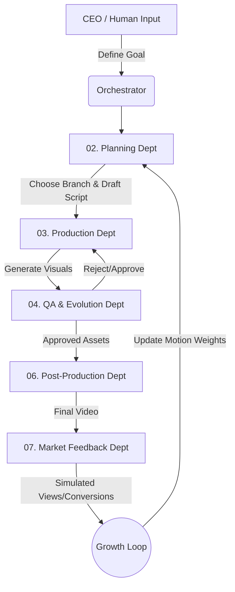

# AI Short Drama Factory

> 🌐 English | [中文](./README_CN.md)

This is an end-to-end, fully automated **AI Short Drama Content Production Factory**.

It is not just a collection of scripts, but a fully automated digital studio that manages the entire lifecycle of short videos—from market research and script generation to video/image asset generation, automated QA inspection, post-production synthesis, and market feedback with self-evolution.

> **[Latest Progress]**: The system has completed all core business logic orchestration and CLI prototype validation (Agentic QA Orchestrator). We are currently initiating a comprehensive **Web Architecture Refactoring (Vite+React + FastAPI)** to provide a commercial-grade, interactive SaaS delivery experience.

---

## 📺 Demo Showcase

We have selected an "AI Dance and Visual Hook" case completely driven by AI for your reference. This video was entirely automated by the Orchestrator (after rigorous physical consistency reinforcement and limb distortion interception):

- [▶️ Watch Demo Video: C006_Yumi_dance](./demo/demo_C006_Yumi_dance.mp4)

---

## 🚀 Key Highlights

- 🎬 **Autonomous Agentic Pipeline** — Complete workflow orchestrated by an automated system, replacing human intervention in drafting, prompt generation, QA, and editing.
- 🎭 **3 Specialized Creative Branches** — Optimized production logic for Voiceovers, Live-Action, and AI Dance hooks.
- 🤖 **Global Quality Assurance (QA)** — Enforces strict physical consistency and text rules, rejecting logic errors and visually distorted outputs.
- 🧬 **Growth Loop Engine** — Simulates market performance to automatically adjust character motion weights (e.g., dynamically prioritizing high-converting dance moves).
- 🧩 **IP Asset Management** — Built-in `character_bible.json` and `motion_library.json` for consistent character generation and reusable visual hooks.

---

## 🎥 3 Core Creative Branches

The Planning Agent supports three deeply customized generation paths based on your content strategy:

### 1. Voiceover Branch (Strict Physics)
- **Focus**: Delivery of information, reviews, or storytelling driven by a narrator.
- **Rules**: Extremely strict QA on physical logic (e.g., character actions must match the real world, no weird limbs).
- **Execution**: Automatically matches the pacing with a TTS (Text-to-Speech) voiceover track.

### 2. Live-Action Branch (Advanced Interactions)
- **Focus**: Dramatic conflicts, plot twists, and multi-character interactions (Mini-series format).
- **Rules**: Enforces dialogue consistency, dynamic camera angles, and character interaction logic.
- **Execution**: Uses synchronized lip-sync/TTS and complex scene building.

### 3. Dance Factory Branch (Visual & Motion Hooks)
- **Focus**: High-impact visual hooks, AI dance trends, and conversion-driven aesthetics.
- **Rules**: *Exempt from strict physical limitations*. This branch skips restrictive QA rules to allow for exaggerated, highly dynamic dancing motions.
- **Execution**: Completely bypasses TTS narration generation. Relies purely on visual hooks (e.g., `Dance001` motion), BGM pacing, and high-contrast text overlays to grab viewer attention in the first 3 seconds.

---

## 🏭 Factory Pipeline Architecture



## 📁 Project Structure

```
ai-short-drama-agent-company/
├── config/                          # Global configurations and requirements
├── docs/                            # Improvement logs and SOPs
├── scripts/                         # Utility scripts (skills downloaders, mocks)
├── tests/                           # Unit and evolution tests
├── departments/                     # Core Agentic Departments
│   ├── 00_global_data/              # Global Assets: character_bible.json, motion_library.json
│   ├── 01_orchestration/            # Sub-pipeline routing
│   ├── 02_planning/                 # Scripting & Branch selection (Planning Agent)
│   ├── 03_production/               # Video and Image generation execution
│   ├── 04_qa_evolution/             # Rule enforcement & Quality Assurance (QA Agent)
│   ├── 05_supervisor/               # Background daemon 
│   ├── 06_post_production/          # Assembly, TTS (if applicable), and FFmpeg rendering
│   └── 07_market_feedback/          # Market simulation and Growth Loop Engine
├── orchestrator.py                  # Main CLI Entry Point (The Factory Manager)
├── pipeline.py                      # Legacy batch pipeline processor
├── main.py                          # Daemon and Web UI Entry Point
├── web_ui/                          # Streamlit CEO Dashboard
├── skills/                          # Reusable agent skills
├── projects/                        # Active task workspaces (Logs & Intermediate assets)
├── out/                             # Final rendered master outputs
└── demo/                            # Real production demo outputs
```

## 🛠 Getting Started

### 1. Requirements
- Python 3.10+
- FFmpeg installed (`brew install ffmpeg` or `apt-get install ffmpeg`)
- Required Python libraries: `pip install -r requirements.txt`

### 2. Run the Factory
Trigger the orchestrator to start the automated pipeline:

```bash
python3 orchestrator.py
```

1. Enter your **Marketing Goal** (e.g., "Sell female swimming goggles").
2. The **Planning Agent** will ask you to confirm your audience and pick one of the **3 Creative Branches**.
3. Let the agents handle storyboard drafting, prompt engineering, generation, QA auditing, and final video assembly.
4. Final generated videos will be saved directly to the `out/` directory.
