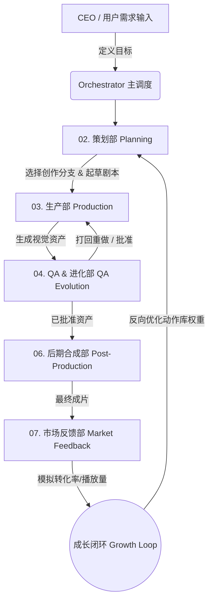

# AI 短剧内容工厂 (AI Short Drama Factory)

> [🌐 English](./README.md) | 中文

一个端到端的、全自动化的 **AI 短剧内容生产工厂**。

这不仅仅是一些脚本的集合，而是一个全自动的数字化制片厂，它管理着短视频的整个生命周期——从市场调研、剧本生成、到视频/图像资产生成、全自动 QA 质检、后期合成以及市场反馈与自我进化。

---

## 🚀 核心亮点

- 🎬 **全自动 Agent 管线** — 由全自动化系统编排的完整工作流，在起草剧本、提示词工程、视频质检及后期剪辑等环节彻底取代人工干预。
- 🎭 **3 大专业创作分支** — 针对不同市场需求，深度优化了【旁白演绎】、【真人剧场情景】与【AI 舞蹈与视觉钩子】的制作逻辑。
- 🤖 **全局质量控制 (QA)** — 强制执行物理一致性与文本规范检查，自动驳回逻辑错误或出现视觉畸变（如肢体错乱）的生成结果。
- 🧬 **成长闭环引擎 (Growth Loop)** — 通过模拟市场转化表现，自动调整动作库中的权重（例如，动态提高能带来高转化的“舞蹈动作”的使用概率）。
- 🧩 **IP 资产管理** — 内置 `character_bible.json`（角色圣经）与 `motion_library.json`（动作库），确保角色 IP 的稳定生成和视觉钩子的高效复用。

---

## 🎥 3 大核心创作分支

策划部 (Planning Agent) 会根据您的内容策略，支持生成以下三种深度定制的短剧：

### 1. 旁白演绎分支 (Voiceover Branch)
- **核心定位**：以旁白、画外音驱动的信息传递、产品评测或叙事。
- **规则要求**：极度严格的物理逻辑 QA 质检（例如：人物动作必须符合现实物理规律，严禁出现奇怪的肢体变形）。
- **执行方式**：自动生成配音 (TTS)，并根据配音长度自动匹配视频节拍。

### 2. 真人剧场情景分支 (Live-Action Branch)
- **核心定位**：强调戏剧冲突、剧情反转以及多角色的复杂互动（类似于微短剧）。
- **规则要求**：强制要求对白的一致性、动态机位切换以及角色互动的合理性。
- **执行方式**：使用同步的唇形/TTS 生成，并构建复杂的情景镜头。

### 3. AI 舞蹈与视觉钩子分支 (Dance Factory Branch)
- **核心定位**：高强度的视觉冲击力、AI 舞蹈趋势追踪，以纯视觉转化为导向的短视频。
- **规则要求**：*特赦严苛的物理限制*。该分支跳过了死板的常规物理质检规则，允许极具张力、甚至夸张的舞蹈动作生成。
- **执行方式**：完全跳过 TTS（语音合成）环节。纯粹依赖视觉钩子（如 `Dance001` 动作）、动感的 BGM 节奏以及强对比度的大字卡（Text Overlays）来在黄金 3 秒内抓住观众眼球。

---

## 🏭 工厂流水线架构



## 📁 项目目录结构

```
ai-short-drama-agent-company/
├── config/                          # 全局配置文件和模板
├── docs/                            # 改进日志、说明文档与 SOP
├── scripts/                         # 实用脚本 (如下载技能、生成测试图等)
├── tests/                           # 单元测试与演化测试脚本
├── departments/                     # 核心的 AI Agent 部门
│   ├── 00_global_data/              # 全局资产库：character_bible.json, motion_library.json
│   ├── 01_orchestration/            # 任务调度与状态机
│   ├── 02_planning/                 # 剧本与分镜（支持 3 大创作分支）
│   ├── 03_production/               # 图像与视频生成调用
│   ├── 04_qa_evolution/             # 质量监控与自我演化规则检查
│   ├── 05_supervisor/               # 守护进程
│   ├── 06_post_production/          # 视频/音频合成、TTS 与 FFmpeg 压制
│   └── 07_market_feedback/          # 模拟市场反馈与自动优化引擎 (Growth Loop)
├── orchestrator.py                  # CLI 主调度入口
├── pipeline.py                      # 批量执行管线
├── main.py                          # 守护进程与 Web UI 启动入口
├── web_ui/                          # Streamlit CEO 可视化控制台
├── skills/                          # 可复用的工作区级技能
├── projects/                        # 活跃任务的工作区 (中间资产与日志)
├── out/                             # 最终导出的成片
└── demo/                            # 真实制作示例输出
```

## 🛠 如何开始

### 1. 环境依赖
- Python 3.10+
- 必须安装 FFmpeg (`brew install ffmpeg` 或 `apt-get install ffmpeg`)
- 安装必要的 Python 库: `pip install -r requirements.txt`

### 2. 启动工厂
触发主调度器以启动全自动化生产流水线：

```bash
python3 orchestrator.py
```

1. 输入你的 **营销目标** (例如: "推销女性游泳眼镜")。
2. **策划部 (Planning Agent)** 会在终端与你确认受众，并要求你选择 **3 大创作分支** 之一。
3. 随后，只需让各大部门 Agent 自动处理分镜起草、提示词工程、视频生成、QA 审核和最后的成片合成。
4. 最终生成的视频将直接保存在 `out/` 目录中。