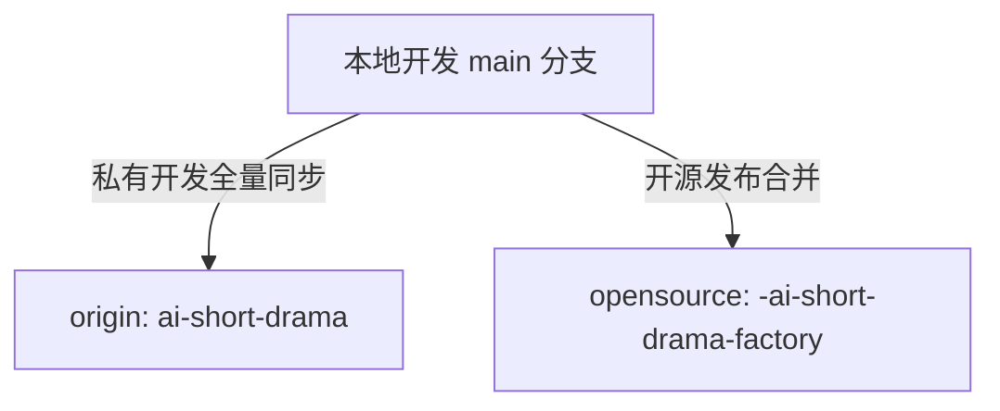

# AI Short Drama Factory - 架构治理与运维回滚 SOP 手册

本手册详细记录了系统的**架构治理规范、测试与脚本分层标准、GitHub 双仓库同步规范以及秒级容灾回滚 SOP**，供团队协作与生产环境运维查阅。

---

## 一、 架构治理与目录规范 (Architecture Overview)

### 1. 核心目录蓝图

```text
ai-short-drama/
├── .env.example                    # 安全环境变量模板 (Git 追踪)
├── .gitignore                      # 强化版脱敏过滤规则 (防泄漏)
├── config/                         # 统一配置中心 (单源真相)
│   ├── company_config.yaml         # 本地实际配置 (已 .gitignore)
│   ├── company_config.yaml.example # 开源配置示例
│   └── 00_requirements.json        # 需求规约基线
├── assets/                         # 媒体与 IP 基础资产 (角色、动作、场景、预设)
├── departments/                    # 虚拟制片厂 7 大流水线部门
│   ├── 00_global_data/             # 全局预设、BGM 库、分镜词典
│   ├── 02_planning/                # 策划与剧本导演引擎
│   ├── 03_production/              # 生图与视频生成智能体 (Agnes API)
│   ├── 04_qa_evolution/            # 质检评估与公司记忆进化
│   ├── 05_supervisor/              # 监制守护进程
│   ├── 06_post_production/        # 剪辑/混音/字幕及蒙太奇合成 (含 montage_adapter)
│   └── 07_market_feedback/        # 市场反馈分析与闭环规律提取
├── shared_tools/                   # 共享基础工具层 (API池、音频、渲染、日志脱敏)
├── skills/                         # 外挂研究与爬虫技能库
├── server/                         # 现代化后端 API 服务 (FastAPI + Worker + SQLite)
├── frontend/                       # 现代化前端看板 (React 18 + Vite + Tailwind)
├── projects/                       # 动态工程执行产物目录 (已 .gitignore)
├── scripts/                        # 运维与资产维护脚本
│   ├── legacy_pipeline/           # 历史单集验证管线归档
│   ├── update_characters.py       # 角色 IP 批量维护脚本
│   └── generate_mock_images.py    # 占位资产生成脚本
├── tests/                          # 分层测试体系
│   ├── unit/                       # 自动化单元测试 (CI 门禁)
│   └── manual/                     # 外部 API 与连通性手工验证脚本
├── orchestrator.py                 # 终端流水线调度主入口
├── pytest.ini                      # 标准化 pytest 配置文件
└── requirements.txt                # 核心依赖清单
```

### 2. 架构核心原则
1. **单源配置中心（Single Source of Truth）**：所有配置文件统一收纳于 `config/`，严禁在根目录创建同名文件夹或散落配置文件。
2. **跨平台动态路径**：所有 Python 脚本一律使用 `os.path.dirname(os.path.abspath(__file__))` 进行动态相对寻址，杜绝硬编码 `/Users/...` 或 `/opt/...` 宿主机绝对路径。
3. **消除路径 Hack**：模块引用统一基于标准包结构与 `pytest.ini` 的 `pythonpath = .`，严禁使用跨部门 `sys.path.append(".../05_xxx")`。
4. **测试分层管理**：
   * `tests/unit/`：用于无外部 Key 依赖的快速测试（如脱敏器、状态机逻辑），由 CI 自动触发。
   * `tests/manual/`：用于需要真实第三方 API（Agnes / MinIO / R2）的手工验证脚本。

---

## 二、 备份机制与版本快照 (Backup Strategy)

系统采用**「Git 里程碑不可变 Tag + 核心私密配置单文件保全」**的轻量级工业化方案，具备**零磁盘浪费、瞬时完成、原子回退**的优势。

### 1. 核心快照节点说明

| 标识符 / 文件 | 类型 | 对应 Commit | 说明 |
| :--- | :---: | :---: | :--- |
| `backup-pre-refactor` | **Git Tag** | `30a094a` | 架构重构前的稳定基线快照（历史回滚锚点） |
| `v1.1-arch-upgrade` | **Git Tag** | `94b2549` | 架构优化完成后的生产里程碑版本 |
| `.env.bak` | **本地文件** | - | 真实 API 密钥本地隔离备份（受 `.gitignore` 保护） |
| `data/app.db.bak` | **本地文件** | - | 本地 SQLite 数据库快照（受 `.gitignore` 保护） |

---

## 三、 GitHub 同步与开源脱敏规范 (Sync Strategy)

根据仓库规范（Rule 6），工程配置了双远程仓库：



### 1. 推送到私有开发主仓库 (Private Development)
将最新代码以及所有备份与里程碑 Tag 同步推送到 GitHub 私有仓库：
```bash
git push origin main --tags
```

### 2. 推送到开源发布仓库 (Open Source Release)
在推送到开源仓库前，确保没有敏感 Key 进入 Git 历史（本项目 `.gitignore` 已配置完备拦截）：
```bash
git push opensource main
```

---

## 四、 应急回滚与运维操作 SOP (Rollback & Ops SOP)

### 1. 秒级原子回滚 SOP (Rollback)

如在后续运行中发现任何非预期问题，需要**完全恢复到重构前的旧版状态**，只需执行以下原子命令：

```bash
# 步骤 1：一键将工作区所有代码与文件树硬回退到重构前基线
git reset --hard backup-pre-refactor

# 步骤 2（可选）：如修改过本地环境变量，还原密钥配置
cp .env.bak .env 2>/dev/null || true
```
> **注意**：`git reset --hard` 是原子级操作，会自动清退本次重构新增的文件，保证工作区 100% 恢复到当时的字节状态。

### 2. 重新前进至优化版本 (Forward Restore)
如回滚排查完毕后需要重新回到最新优化版：
```bash
git reset --hard v1.1-arch-upgrade
```

### 3. 查看版本标签历史
```bash
git tag -n
```

---

## 五、 质量验证与本地流水线执行命令 (Verification Commands)

### 1. 执行自动化单元测试
```bash
pytest
```
*预期结果*：`tests/unit/` 下的所有单测用例 100% 通过（0 error, 0 failure）。

### 2. 前端构建与类型校验
```bash
cd frontend
npm run build
```
*预期结果*：TypeScript 校验通过，Vite 打包产物生成于 `frontend/dist/`。

### 3. 运行主调度器 (Orchestrator)
```bash
python3 orchestrator.py
```
