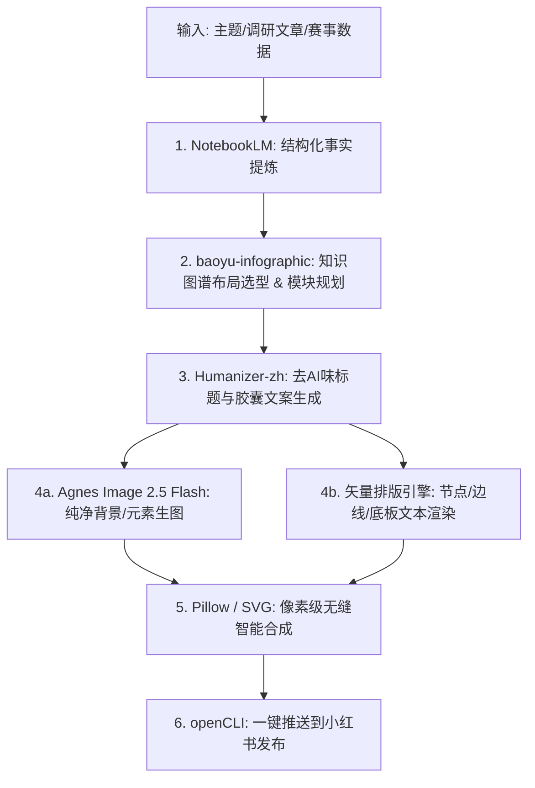

# 知识图谱封面技能（baoyu-infographic & illustrator）统一管理与小红书图文集成指南

> **技能来源**：本地已搭建并验证的 `baoyu-infographic`（宝玉信息图/知识图谱）与 `baoyu-article-illustrator`（文章配图/封面）  
> **统一纳入路径**：  
> - `skills/baoyu-infographic/`（知识图谱、信息图、21种布局×21种风格体系）  
> - `skills/baoyu-article-illustrator/`（图文配图、封面图视觉设计体系）  
> - `skills/baoyu-comic/`（多格漫画、分镜故事板体系）  
> **应用场景**：小红书爆款知识图谱封面、高密度避坑卡片、多图轮播干货笔记生成。

---

## 一、 为什么将此 Skill 作为小红书知识图谱封面的底座？

小红书平台的知识/科技自媒体生态具有极强的**“高密度、强视觉、看图即得”**特征。`baoyu-infographic` 提供了业内最成熟的**信息架构体系**：

### 1. 核心布局体系（专为小红书优化的 5 大王牌布局）
| 布局名称 | 适用小红书场景 | 视觉呈现特征 |
| :--- | :--- | :--- |
| **`dense-modules`（高密模块卡片）** | **小红书第一封面首选**、避坑指南、行业全景 | 6~7 个独立结构化模块，极高信息浓度，带坐标与标记，第一眼即专业感炸裂 |
| **`hub-spoke`（知识图谱辐射）** | 核心概念衍生、一人公司生态拆解 | 中心核心节点辐射多个子模块，箭头与关联线清晰，经典知识图谱形态 |
| **`bento-grid`（便当盒网格）** | 盘点类笔记、多工具/资源推荐清单 | 大小不一的精美色块卡片组合，呼吸感与秩序感兼备 |
| **`hierarchical-layers`（金字塔层级）** | 认知分层、进阶路线图、架构设计 | 从底层到顶层的逐级跃迁，阶梯感极强 |
| **`binary-comparison`（红黑双轨对比）** | 避坑 vs 正确做法、传统模式 vs AI新模式 | 左右双列强反差对比，点击率极高 |

---

## 二、 与本项目“排版解耦架构”的工业化融合工作流

为确保图文生成**100% 杜绝 AI 汉字乱码**，未来创建小红书图文时采用以下标准流水线：

### 执行步骤详解：
1. **结构规划（baoyu-infographic）**：
   - 根据文案主题从 `skills/baoyu-infographic/references/layouts/` 选取对应布局（如 `dense-modules`）；
   - 输出明确的 JSON/Markdown 模块定义（包含主标、副标、3~6个模块的坐标与文案）。
2. **纯净生图（Agnes-Image-2.5-Flash）**：
   - 提取模块中的插画需求（如机器人、奖杯、实验室仪器）；
   - 注入强负向词 `STRICTLY NO TEXT, NO LETTERS, CLEAN BACKGROUND`，生成高质感底图。
3. **矢量合成（PIL / SVG 排版引擎）**：
   - 将 `baoyu-infographic` 规划的文字与关系线，通过系统级中文字体（冬青黑体/华文黑体）直接光栅化覆盖到对应模块区域；
   - 保证文字 100% 锐利清晰、零错别字。
4. **一键分发（openCLI）**：
   - 调用 `npx opencli xiaohongshu publish` 自动发布至小红书。

---

## 三、 快速引用示例

在后续对话或自动化脚本中，只需指定引用该技能即可：
> **指令示例**：  
> *“请引用 `skills/baoyu-infographic` 中的 `dense-modules` 布局与 `craft-handmade` 风格，把本次关于‘一人公司商业模式’的内容，制作成一张小红书高密度知识图谱封面图。”*
