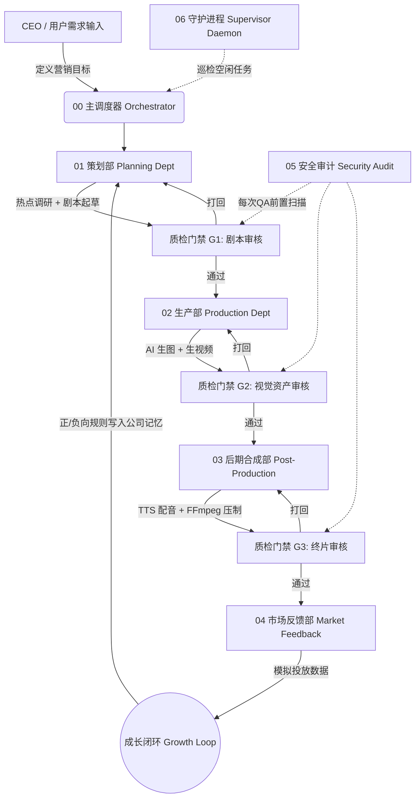

# AI 短剧内容工厂：全自动化数字制片系统 — 产品发言稿

> **文档用途**：本文档可直接输入给 AI 智能体生成 PPT。每页采用"PPT 核心视觉 + 演讲词"双轨结构，按逻辑递进编排。

---

## P1 — 封面

**【PPT 核心视觉】**
- 主标题：AI 短剧内容工厂 (AutoMedia Pipeline)
- 副标题：从营销目标到成片交付的端到端"黑灯工厂"
- 背景视觉：流水线工厂蓝图 + AI 科技光效
- 底部信息：演讲者 / 日期 / 版本号 v1.0.0

**【🗣️ 演讲词】**
各位领导、各位合作伙伴，大家好。今天我将向大家完整介绍我们团队自主研发的"AI 短剧内容工厂"。这不是一个零散的脚本工具集合，而是一整套端到端的、全自动化的"数字制片厂"——它管理着短视频内容的完整生命周期：从市场调研、剧本创作、AI 画面生成、多轮质检、语音合成、后期剪辑，一直到市场投放反馈与系统自我进化。

---

## P2 — 行业痛点：为什么需要这个产品？

**【PPT 核心视觉】**
- 左侧：传统短视频制作流程（编剧→拍摄→剪辑→投放，标注"3-7天/条"）
- 右侧：AI 工厂流程（目标→成片，标注"分钟级"）
- 中间：大字"10x 效率提升"

**【🗣️ 演讲词】**
在短视频营销爆发的今天，内容产出的速度永远追不上流量消耗的速度。传统制作依赖人工编剧、实景拍摄、人工剪辑，一条30秒短视频至少需要3到7天。而且试错成本极高——花了三天拍好的片子，投放后发现完播率只有5%，推倒重来。我们的产品要解决的就是这个根本问题：**用全自动化的 AI Agent 协作网络，将"创意到成片"压缩到分钟级别，并且让系统自己从市场数据中学习，越用越聪明。**

---

## P3 — 产品全景：七大 AI 部门协作架构

**【PPT 核心视觉】**
- 核心架构流程图（Mermaid 风格）：

- 在流程图旁列出 7 大部门名称与职责

**【🗣️ 演讲词】**
我们的系统模拟了一家真实影视公司的组织架构，由 7 个独立的 AI Agent 部门组成：
1. **主调度器 (Orchestrator)** —— 全局状态机，驱动工单在部门间流转；
2. **策划部 (Planning Dept)** —— 负责热点调研、与 CEO 交互确认需求、起草分镜剧本；
3. **生产部 (Production Dept)** —— 调用 AI 生图 / 生视频 API，将剧本转化为视觉资产；
4. **QA 与进化部 (QA & Evolution Dept)** —— 三层质量门禁，兼备安全审计与自我进化引擎；
5. **后期合成部 (Post-Production Dept)** —— TTS 配音 + FFmpeg 视频混流压制；
6. **守护进程 (Supervisor Daemon)** —— 后台巡检空闲工单，自动调度补位；
7. **市场反馈部 (Market Feedback Dept)** —— 模拟投放效果，驱动成长闭环。

每一个部门都是一个独立的 Python Agent，通过工单状态机松耦合协作。这意味着任何一个部门都可以被单独替换或升级，而不影响整体流程。

---

## P4 — 核心优势 ①：三大创作分支，一键切换制片模式

**【PPT 核心视觉】**
- 三列并排卡片，分别为：
  - 🎙️ 旁白演绎 (Voiceover Branch)
  - 🎬 真人剧场 (Live-Action Branch)
  - 💃 AI 舞蹈与视觉钩子 (Dance Factory Branch)
- 每张卡片列出：定位、规则特性、执行方式

**【🗣️ 演讲词】**
为了快速适配不同的营销场景，策划部内置了三大创作分支，CEO 在启动时一键选择即可：

**第一分支：旁白演绎。** 适合产品种草和信息传递。系统会执行最严格的物理约束规则——画面以静态中景和特写为主，严禁复杂的肢体交互（因为 AI 视频模型极易在"握手""奔跑"等动作上生成肢体畸变）。旁白自动走 TTS 语音合成，并严格执行"字秒比铁律"：每 5 秒不超过 20 个汉字，确保语速自然不被截断。

**第二分支：真人剧场情景。** 适合剧情反转和角色互动类微短剧。系统允许多角色对白、戏剧冲突和镜头语言设计，但依然约束复杂物理动作。配音会自动识别角色标签（如"男：""女："），分配不同的音色——男性角色用 YunxiNeural（磁性男声），女性角色用 XiaoxiaoNeural（温柔女声），并自动剥离角色名前缀，只合成纯对白。

**第三分支：AI 舞蹈与视觉钩子。** 这是我们最具特色的分支——完全不使用旁白和对白，纯靠视觉冲击力在前 3 秒抢夺用户注意力。系统会加载角色圣经 (Character Bible) 和动作库 (Motion Library)，从预设的舞蹈动作（如"轻微摇摆""HipHop 律动""比心"等）中按权重抽取动作组合。这个分支特赦了严格的物理约束检查，允许夸张的动态表达。

---

## P5 — 核心优势 ②：全局状态机驱动的工单流转与防死锁机制

**【PPT 核心视觉】**
- 状态流转图：Pending → Requirements_Gathering → Drafting → QA_Pending_Planning → Draft_Completed → QA_Pending_Production → Assets_Generated → QA_Pending_Final → Market_Testing → Completed
- 标注分支：Paused_By_Error / Security_Halted
- 防死锁触发器标注：连续失败 ≥ 3 次自动熔断

**【🗣️ 演讲词】**
整个系统的流转由一个精心设计的工单状态机驱动。工单从 `Pending` 状态出发，依次流经策划、质检、生产、后期、市场反馈等节点，最终到达 `Completed`。每一次状态变更都伴随着工单 JSON 的持久化写入，确保任何时刻中断都能恢复。

为了防止 AI 生成失败导致的无限重试死锁，我们设计了**防死锁熔断器**：如果某个节点连续失败 3 次，系统自动将状态切换为 `Paused_By_Error`，停止循环并通知 CEO 介入。此外，系统还支持**历史任务恢复**——直接回车即可找到最近一次未完成的工单，从中断点继续执行。

---

## P6 — 核心优势 ③：三层质量门禁 + 安全审计

**【PPT 核心视觉】**
- 纵向堆叠展示三层门禁：
  - 🛡️ G0：安全审计层（Skills 安全扫描 + Luban 验料）
  - 📝 G1：剧本质检层（字数铁律 + 幕数上限 + 物理动作检查 + LLM 语义审查）
  - 🎬 G2：视觉资产质检层（文件存在性 + 时间戳指纹 + 视频内容深度审计：黑屏检测 / ffprobe）
  - 🎞️ G3：终片质检层（FFmpeg 完整性验证）

**【🗣️ 演讲词】**
质量控制是我们区别于其他 AI 内容工具的核心壁垒。我们部署了三层硬质量门禁，外加一层前置安全审计：

**安全审计层 (G0)**：每次 QA 触发前，系统会自动扫描整个 Skills 目录中所有 `.py`、`.sh`、`.js` 文件，检测是否存在 `os.system`、`eval()`、`exec()` 等危险代码模式。同时引入"鲁班验料"机制——没有 README 的技能包视为不可信，直接拦截。对于白名单内的可信第三方工具则自动放行。

**剧本质检层 (G1)**：首先进行硬编码前置校验——每句旁白/台词不超过 20 个字（含标点），总幕数不超过上限。然后调用 LLM 进行语义级审查，检测是否存在复杂物理动作词汇、核心产品遗漏等问题。舞蹈分支享受物理动作特赦豁免。

**视觉资产质检层 (G2)**：验证每个镜头的图片和视频文件是否存在、时间戳是否匹配当前工作流（防止旧资产被误用）。更关键的是执行**视频内容深度审计**——通过文件大小启发式判断（小于 50KB 极可能是纯黑废片）和 FFmpeg `blackdetect` 滤镜检测是否存在超过 2 秒的连续纯黑帧。

**终片质检层 (G3)**：验证最终合成的 Master 视频文件完整性和时间戳一致性。

任何一层未通过，工单都会被**自动打回到上游部门重做**，并将 QA 反馈注入下一轮生成的提示词中（通过 `<CRITICAL_CORRECTION>` 标签强制 LLM 严格遵从），形成闭环修正。

---

## P7 — 核心优势 ④：自我进化的公司记忆系统

**【PPT 核心视觉】**
- 双向循环图：
  - QA 打回 → 提炼负向规则 → 写入 company_memory.json → 下一轮剧本生成自动注入
  - 市场爆款 → 提炼正向规则 → 写入 company_memory.json → 下一轮创作自动参考
- 展示 company_memory.json 示例

**【🗣️ 演讲词】**
这是我们最引以为豪的设计——**公司记忆系统 (Company Memory)**。系统内置了一个共享的记忆文件 `company_memory.json`，分为"正向模式 (positive_patterns)"和"负向模式 (negative_patterns)"两个列表。

**负向进化**：每当 QA 部门打回一份剧本，系统会自动调用 LLM 分析打回原因，提炼出一条不超过 30 字的通用规避教训。但在写入前，它会先比对现有规则库，避免重复写入已知规则。只有真正"新维度"的错误才会被记录。

**正向进化**：当一部短剧在市场模拟投放中获得高完播率和高转化率（"爆款"判定），市场反馈部会自动剖析其剧本结构，提炼出正向营销法则。

**记忆压缩**：为了防止规则列表无限膨胀，系统采用 **LLM 驱动的语义压缩**——当规则数超过阈值时，自动合并语义相近的规则，将条目压缩到 5 条以内。同时，带有 `[CEO]` 前缀的规则拥有最高执行权限，在任何压缩操作中都绝对受保护、永不被覆盖。

这些动态记忆会在每一轮剧本生成时自动注入策划部的系统提示词中，形成"越用越聪明"的闭环。

---

## P8 — 核心优势 ⑤：市场反馈驱动的成长闭环 (Growth Loop)

**【PPT 核心视觉】**
- 循环图：终片 → 模拟投放 → 数据分析（播放量/完播率/转化率）→ 判定爆款或劣片 → 反向更新资产库权重 → 影响下一轮创作
- 双向箭头：动作库 motion_library.json 的权重升降

**【🗣️ 演讲词】**
成长闭环是系统的第七个部门——市场反馈部。它会为每部成片模拟一组投放数据：播放量、完播率和转化率。然后根据阈值自动判定——完播率超过 30% 且转化率超过 2% 且播放量超过 10 万，判定为"爆款"；完播率低于 10% 或转化率低于 0.5%，判定为"劣片"。

对于标准剧本分支（旁白或真人剧场），爆款会被提炼正向法则、劣片会被提炼负向教训，写入公司记忆。

但对于**舞蹈分支**，进化逻辑更加精细——系统会提取剧本中使用的具体动作 ID（如 Dance001、Dance003），然后在动作库 `motion_library.json` 中直接**调整该动作的生成权重**：爆款奖赏 +0.5，劣片惩罚 -0.5。这意味着，那些能带来高转化的舞蹈动作，会在后续的创作中被更高概率地选中——**系统在市场验证中自主学习哪种动作最带货**。

---

## P9 — 核心优势 ⑥：IP 资产管理与一致性保障

**【PPT 核心视觉】**
- 左侧：角色圣经 (Character Bible) 示例卡片
  - Goth Girl：哥特风、紫色挑染双马尾、暗黑美学
  - Fitness Coach：运动风、高马尾、瑜伽裤
- 右侧：动作库 (Motion Library) 列表
  - Dance001 轻微摇摆 | Dance003 镜头靠近 | Dance006 比心
  - 每个动作带权重值

**【🗣️ 演讲词】**
为了保证内容矩阵的 IP 一致性，我们建立了两个核心全局资产库：

**角色圣经 (Character Bible)**：每个虚拟角色都有完整的外观描述、性格标签、正向提示词 (appearance_prompt) 和反向提示词 (negative_prompt)。策划部在生成分镜时，会强制将角色的 appearance_prompt 嵌入每一个镜头的英文提示词中。这确保了同一个角色在不同短剧中的视觉一致性。

**动作库 (Motion Library)**：预设了一系列经过验证的动作组合，每个动作都有标准英文提示词、建议时长和动态权重。权重会被市场反馈部的成长闭环实时调整。

---

## P10 — 核心优势 ⑦：实时热点调研与知识蒸馏

**【PPT 核心视觉】**
- 调研链路图：
  - Agent-Reach CLI → B站 / 小红书
  - last30days-cn → 全网30天热点
  - LLM Fallback → 虚构爆款案例
- 蒸馏结果：原始数据 → "1句话动态特征" → 注入剧本 System Prompt

**【🗣️ 演讲词】**
在剧本创作之前，策划部会自动执行实时热点调研。系统集成了两套本地 CLI 工具：
- **Agent-Reach**：直接搜索 B 站和小红书的热门内容；
- **last30days-cn**：抓取近 30 天全网相关话题的爆款数据。

如果本地工具不可用，系统会自动降级到 LLM 知识回退模式——强制 LLM 基于领域认知虚构 3 个高仿真爆款案例（而非输出"我无法联网"的无用回复）。

更关键的是**知识蒸馏**环节：拿到原始调研数据后，系统会用 LLM 提炼出一句话的"最新趋势动态特征"——例如"悬念钩子+极致对比，精准直击痛点促转化"——作为本次创作的最高指导原则，直接注入剧本生成的提示词中。这确保了每一次创作都紧贴当下市场热点。

---

## P11 — 核心优势 ⑧：行业级营销 SOP 内置

**【PPT 核心视觉】**
- 四段式横向时间轴：
  1. 🪝 黄金 3 秒 (The Hook) — 痛点引入 / 制造悬念
  2. 💡 解决方案 (The Solution) — 核心产品登场
  3. ✅ 功效体验 (The Proof) — 前后对比 / 证言
  4. 📢 行动号召 (CTA) — 转化引导

**【🗣️ 演讲词】**
系统内置了经过百万级数据验证的"短视频营销爆款四段式 SOP"。每次生成剧本时，策划部的 System Prompt 中都会自动注入这套 SOP 作为强制叙事逻辑框架。需要特别强调的是——这四段是逻辑模块，不是固定的幕数。实际镜头数量由系统根据最大时长（可配置，默认 60 秒，每幕最多 5 秒）动态计算，可以细化至 8-12 幕，超限会被 QA 自动驳回。

---

## P12 — 核心优势 ⑨：智能配音系统（多角色音色 + 文本清洗）

**【PPT 核心视觉】**
- 流程图：剧本台词 → 角色标签解析（男/女/旁白）→ 音色分配（YunxiNeural / XiaoxiaoNeural）→ Edge-TTS 合成 → macOS Say 兜底
- 对比示例：
  - ❌ 原始输入："男："别折腾，试试这个。""
  - ✅ 实际合成："别折腾，试试这个。"（磁性男声）

**【🗣️ 演讲词】**
在语音合成环节，我们解决了一个行业常见的质量事故：**角色标签被当作台词朗读**。系统会用正则表达式智能解析台词中的角色前缀（如"男：""女："或英文角色名），自动剥离标签、去除引号，只将纯净的对白文本交给 TTS 引擎。同时根据角色关键词自动分配音色——男性角色使用 YunxiNeural 磁性男声，女性角色使用 XiaoxiaoNeural 温柔女声。

TTS 引擎优先使用微软 Edge-TTS 进行高质量神经网络语音合成，若 Edge-TTS 不可用则无缝降级到 macOS 原生 `say` 命令（同样支持男女声切换）。舞蹈分支则完全跳过 TTS，保持纯视觉冲击力。

---

## P13 — 核心优势 ⑩：去 AI 味文本后处理

**【PPT 核心视觉】**
- 对比卡片：
  - ❌ AI 原始输出："本产品采用先进的防雾技术，有效提升您的游泳体验。"
  - ✅ 去 AI 味后："戴上就完事了，水下贼清楚，跟没戴一样！"

**【🗣️ 演讲词】**
AI 生成的台词最大的问题就是"塑料味"——过于书面、过于规整、一听就是机器写的。我们在策划部中集成了独立的"去 AI 味洗稿模块 (qu-ai-wei)"。当剧本初稿生成后，系统会自动调用此模块，将所有旁白和台词重写为碎片化、口语化的真人质感文本，同时严格控制字数不超过上限。这个模块的核心技能指南来自我们内部沉淀的专属 Skill 文件，确保每一句台词都经得起"听感测试"。

---

## P14 — 技术架构与跨进程 LLM 资源池

**【PPT 核心视觉】**
- 技术栈列表：
  - 🐍 Python 3.10+ | FastAPI (Web UI 备选)
  - 🎨 AI 生图：Agnes Image 2.1 Flash API
  - 🎬 AI 生视频：Agnes Video v2.0 API (Img2Vid + 轮询)
  - 🗣️ TTS：Edge-TTS / macOS Say
  - 🎞️ 后期：FFmpeg（音视频合成 + 黑屏检测 + 片段拼接）
  - 🧠 LLM：Agnes 2.0 Flash（多 Key 跨进程资源池）
  - 📊 CEO Dashboard：Streamlit Web UI
  - 🐳 部署：Docker + Docker Compose
- LLM Pool 架构图：4 个 API Key 轮转 + 文件锁 + RPM 限速 + 429 自动退避

**【🗣️ 演讲词】**
在底层架构上，我们设计了一套**跨进程 LLM 资源池 (LLM Pool)**。由于多个 Agent 部门会并发调用 LLM API，而免费 API Key 通常有每分钟请求数限制（RPM），我们通过文件级互斥锁 (`fcntl.flock`) 实现了跨进程的速率控制——4 个 API Key 按各自的 RPM 上限轮转调度，收到 429 限速响应后自动退避该 Key 60 秒。这确保了即使在高并发场景下，系统也不会因为 API 限流而崩溃。

生产部的 AI 生图和生视频采用了"先生图 → 再图生视频 (Img2Vid)"的两段式流程，中间通过异步轮询等待视频渲染完成（每 30 秒轮询一次，最长等待 60 分钟）。每个镜头还支持并发生成，极大提升了多幕剧本的生产效率。所有 API 调用都配备了多 Key 轮转和完善的重试机制（最多 20 次重试），在 API 全部离线时自动降级生成本地 Mock 资产以保证流程不中断。

---

## P15 — CEO 可视化控制台与部署方案

**【PPT 核心视觉】**
- CEO Dashboard 截图模拟：三个 Tab
  - 🎯 目标下达区：表单输入营销目标
  - 📊 执行看板：全项目 Kanban 状态板
  - ⚖️ 审批中心：Human-in-the-Loop 审批节点
- Docker Compose 部署架构图

**【🗣️ 演讲词】**
对于管理层，我们提供了基于 Streamlit 的 CEO Dashboard Web 控制台。CEO 可以通过三个功能区进行操控：
- **目标下达区**：直接在网页表单中输入营销目标，一键派发工单；
- **执行看板**：全景展示所有项目的流转状态和进度百分比；
- **审批中心**：当某些节点需要人类介入决策时（如剧本审批），CEO 可以在线批准或退回并附上修改意见。

在部署方面，整个系统支持 Docker 容器化一键部署。`docker-compose.yml` 中定义了资源限制和卷挂载，配置文件集中管理于 `config/company_config.yaml`，环境变量统一在 `.env` 中配置——包括各部门的 API Key、LLM 模型选择、视频时长上限、单幕旁白字数上限等，全部可通过配置调整而无需修改代码。

---

## P16 — 已验证的实际项目案例

**【PPT 核心视觉】**
- 项目列表卡片（从 `projects/` 目录提取）：
  - 📁 推销女性游泳眼镜
  - 📁 儿童书包营销
  - 📁 女性泳衣营销广告
  - 📁 推销日用花露水（六神花露水）
  - 📁 PaperAI 系列短剧
- 每个项目标注使用的创作分支

**【🗣️ 演讲词】**
系统已经在多个真实营销场景中完成了端到端的验证。从快消品（花露水）、运动用品（游泳眼镜、儿童书包、女性泳衣），到 SaaS 软件产品（PaperAI 系列短剧），覆盖了从实体商品到虚拟服务的多种品类。每个项目都独立存储在 `projects/` 目录下，拥有完整的运行日志、中间资产和最终成片，支持随时复盘和恢复。

---

## P17 — 可扩展性：技能插件生态

**【PPT 核心视觉】**
- Skills 插件列表（从 `skills/` 目录提取）：
  - 🔍 agent-reach — 社交平台爬取工具
  - 📅 last30days-skill-cn — 30天热点调研
  - 🎬 video-spec-builder — 视频规格方法论
  - 🔨 luban-skill — 技能验料与质量审计
  - 🐦 x-research-skill — X/Twitter 研究
  - 🌍 empire-of-dust-youtube-pipeline — YouTube 管线
  - 🎞️ seedance-prompt-splitter — 视频提示词拆分
  - 📊 short-drama-research-intake — 短剧调研

**【🗣️ 演讲词】**
系统采用了开放的技能插件架构。`skills/` 目录下可以挂载任意数量的外部工具和研究脚本。我们已经预装了 10 个专业技能包，覆盖社交平台爬取、热点调研、视频规格构建、安全审计等能力。未来客户可以根据自己的业务需求，轻松开发并挂载新的技能包——只需遵循 README 文档规范，系统的安全审计层会自动对其进行合规扫描。

---

## P18 — 总结与行动号召

**【PPT 核心视觉】**
- 核心价值总结矩阵（2×3 网格）：
  - 🏭 全自动流水线 | 🎭 三大创作分支
  - 🛡️ 三层质量门禁 | 🧬 自我进化记忆
  - 📊 数据驱动闭环 | 🐳 分钟级容器部署
- CTA：扫码体验 / 预约 Demo

**【🗣️ 演讲词】**
最后做一个总结。我们的 AI 短剧内容工厂，核心价值可以浓缩为六个关键词：
1. **全自动**：从营销目标到最终成片，全程无需人工干预；
2. **三分支**：旁白、剧场、舞蹈，一键切换制片模式；
3. **强质控**：三层质检门禁 + 安全审计，杜绝废片和安全风险；
4. **会进化**：公司记忆系统 + 动作库权重调整，越用越懂市场；
5. **数据驱动**：市场投放闭环反哺创作，让 ROI 持续提升；
6. **秒级部署**：Docker 容器化，配置文件驱动，即插即用。

非常期待接下来能和各位深入探讨具体的落地场景。无论您是电商带货、品牌营销还是 IP 孵化，我们都可以快速跑通第一个 AI 短剧项目。谢谢大家！
