# 全流程团队评审报告：测试问题修复实施计划（v2）

> **评审日期**：2026-07-31  
> **参与角色**：产品 · 开发 · 测试 · 安全 · 架构 · 运维 · 运营 · 法务 · UX  
> **输入材料**：原始 6 项修复方案 + 全代码库深度审计

---

## 一、评审总结

原始修复计划覆盖了 6 项核心风险，但全流程团队在评审中 **额外发现了 7 项遗漏的关键问题**，其中 2 项为 P0 级（密钥硬编码已入 Git 历史、SSL 全局禁用），必须在原始修复中一并处理。

| 优先级 | 条目数 | 说明 |
|--------|--------|------|
| **P0 紧急** | 4 项 | 密钥泄漏/安全漏洞，必须立即修复 |
| **P1 高危** | 5 项 | 运行时 Bug / 功能失效，阻塞生产流水线 |
| **P2 改善** | 4 项 | 代码卫生 / 可维护性 / 测试稳定性 |

---

## 二、评审发现：原始方案新增 & 补充意见

### 🔴 安全组评审意见

> [!CAUTION]
> **新发现 S1：多个文件硬编码了真实 API 密钥（P0）**  
> 这比 `production_agent.py` 的日志泄漏更严重。以下文件直接包含明文 `sk-` 密钥：
> - [test_api.py:4](file:///Users/workspace/ai_short_company/ai-short-drama/test_api.py#L4)
> - [test_api2.py:4](file:///Users/workspace/ai_short_company/ai-short-drama/test_api2.py#L4)
> - [test_api3.py:5](file:///Users/workspace/ai_short_company/ai-short-drama/test_api3.py#L5)
> - [verify_keys.py:8-11](file:///Users/workspace/ai_short_company/ai-short-drama/verify_keys.py#L8-L11)
>
> 虽然 `.gitignore` 中有 `test_*.py` 和 `verify_keys.py`，但如果它们曾被提交过，密钥已存在于 Git 历史中。**需立即轮换这些密钥**。

> [!CAUTION]
> **新发现 S2：SSL 证书校验在多处被全局关闭（P0）**  
> 以下位置使用 `ssl.CERT_NONE` 或 `verify=False`，使所有 LLM API 调用暴露在中间人攻击风险下：
> - [api_pool.py:158-160](file:///Users/workspace/ai_short_company/ai-short-drama/shared_tools/api_pool.py#L158-L160) — **核心调用链路**
> - [pipeline.py:16](file:///Users/workspace/ai_short_company/ai-short-drama/pipeline.py#L16)
> - [test_urllib_alpn.py:9](file:///Users/workspace/ai_short_company/ai-short-drama/test_urllib_alpn.py#L9)
> - [scripts/download_skills.py:19](file:///Users/workspace/ai_short_company/ai-short-drama/scripts/download_skills.py#L19)

> [!WARNING]
> **S3 补充意见：`api_pool.py:262` 同源密钥泄漏（P0）**  
> `call_llm()` 在 `api_pool.py` 中通过 `curl` 发起调用（L209-226），异常时 L262 直接打印 `e`，
> 与 `production_agent.py:38` 是 **完全相同的泄漏模式**。两处必须同步修复。

### 🟡 架构组评审意见

> [!WARNING]
> **新发现 A1：`requests_mock.py` 放在项目根目录，遮蔽标准库（P1）**  
> [requests_mock.py](file:///Users/workspace/ai_short_company/ai-short-drama/requests_mock.py) 位于项目根目录，当 `sys.path` 包含项目根时，任何 `import requests` 都会导入这个假模块而非真实的 `requests` 库。这导致依赖 `requests` 的代码（如 `planning_agent.py:565` 的 Web 轮询）静默失败。

> [!IMPORTANT]
> **A2 补充意见：`audit_planning()` 硬编码文件名 `01_storyboard.md`（P1）**  
> [qa_agent.py:147](file:///Users/workspace/ai_short_company/ai-short-drama/departments/04_qa_evolution/qa_agent.py#L147) 中 `audit_planning()` 写死了 `01_storyboard.md`，但舞蹈分支生成的是 JSON 文件。虽然 `load_and_parse()` 内部会尝试 JSON 解析，但如果文件实际命名为 `.json`，`os.path.exists()` 就会返回 `False`，导致舞蹈剧本直接被判"未找到"而 FAIL。

### 🟢 测试组评审意见

> [!NOTE]
> **新发现 T1：重复导入与死代码（P2）**  
> - [qa_agent.py:4-5](file:///Users/workspace/ai_short_company/ai-short-drama/departments/04_qa_evolution/qa_agent.py#L4-L5)：`import sys` 重复两次
> - [planning_agent.py:3-4](file:///Users/workspace/ai_short_company/ai-short-drama/departments/02_planning/planning_agent.py#L3-L4)：`import time` 重复两次
> - [qa_agent.py:137-140](file:///Users/workspace/ai_short_company/ai-short-drama/departments/04_qa_evolution/qa_agent.py#L137-L140)：`audit_chat_context()` 在 L135 `return` 后有 4 行不可达代码

> [!NOTE]
> **T2 补充意见：`config_loader.py` 每次调用都重新解析 `.env`（P2）**  
> [config_loader.py:19-22](file:///Users/workspace/ai_short_company/ai-short-drama/shared_tools/config_loader.py#L19-L22) 的 `get_config()` 每次都调用 `load_env()` 重新读磁盘解析。在高频调用场景（如 API Pool 的每次限流检查）中产生不必要的 IO 开销。

### 🔵 产品 & 运营组评审意见

> [!IMPORTANT]
> **P1 补充意见：原始方案 #1（QA Prompt 冲突）的修复需保留可审计性**  
> 产品组要求：修复后的 Prompt 分支逻辑应在 QA 日志中明确输出"当前使用了哪套卡控规则集"，方便运营追溯误拒/漏放的根因。不能只是静默跳过公共规则。

---

## 三、完整修复方案（13 项，按优先级排列）

---

### P0-1：清除硬编码密钥 + 密钥轮换 ⚡
**评审角色**：安全 · 法务 · 运维

#### [MODIFY] [test_api.py](file:///Users/workspace/ai_short_company/ai-short-drama/test_api.py)
#### [MODIFY] [test_api2.py](file:///Users/workspace/ai_short_company/ai-short-drama/test_api2.py)
#### [MODIFY] [test_api3.py](file:///Users/workspace/ai_short_company/ai-short-drama/test_api3.py)
#### [MODIFY] [verify_keys.py](file:///Users/workspace/ai_short_company/ai-short-drama/verify_keys.py)

**修改内容**：
- 将所有硬编码的 `sk-xxx` 替换为 `os.environ.get("AGNES_API_KEY_1", "")` 或 `get_config()` 引用。
- 为每个脚本添加 `if __name__ == "__main__":` 保护。
- 在 `.gitignore` 中确认 `verify_keys.py` 和 `test_*.py` 已被忽略（当前已有，但需确认 Git 历史）。

**运维动作（手工）**：
- 立即在 Agnes AI 控制台轮换所有暴露的 API Key。
- 运行 `git log --all --diff-filter=A -- 'test_api*.py' 'verify_keys.py'` 检查是否曾入库。如果曾入库，需要 `git filter-repo` 清洗历史或认定密钥已泄漏。

---

### P0-2：日志脱敏（`production_agent.py` + `api_pool.py` 同步修复） ⚡
**评审角色**：安全 · 开发

#### [MODIFY] [production_agent.py](file:///Users/workspace/ai_short_company/ai-short-drama/departments/03_production/production_agent.py)
#### [MODIFY] [api_pool.py](file:///Users/workspace/ai_short_company/ai-short-drama/shared_tools/api_pool.py)

**修改内容**：

在 `shared_tools/` 中新增统一脱敏函数，两处同时引用：

```python
# shared_tools/log_sanitizer.py (NEW)
import re

_SENSITIVE_PATTERNS = [
    (re.compile(r'(Bearer\s+)\S+', re.I), r'\1***REDACTED***'),
    (re.compile(r'(sk-)\S+'), r'\1***REDACTED***'),
    (re.compile(r'(wk-)\S+'), r'\1***REDACTED***'),
    (re.compile(r'(X-goog-api-key:\s*)\S+', re.I), r'\1***REDACTED***'),
    (re.compile(r'(Authorization:\s*)\S+', re.I), r'\1***REDACTED***'),
]

def sanitize(text: str) -> str:
    for pattern, replacement in _SENSITIVE_PATTERNS:
        text = pattern.sub(replacement, text)
    return text
```

**`production_agent.py` L37-38**：
```diff
-    except Exception as e:
-        print(f"[cURL] Error: {e}")
+    except subprocess.CalledProcessError as e:
+        from shared_tools.log_sanitizer import sanitize
+        print(f"[cURL] Error: {sanitize(str(e))}")
+    except Exception as e:
+        from shared_tools.log_sanitizer import sanitize
+        print(f"[cURL] Error: {sanitize(str(e))}")
```

**`api_pool.py` L261-262**：
```diff
-        except Exception as e:
-            print(f"  [LLM API Error] {e}")
+        except Exception as e:
+            from shared_tools.log_sanitizer import sanitize
+            print(f"  [LLM API Error] {sanitize(str(e))}")
```

---

### P0-3：修复 SSL 证书校验全局禁用 ⚡
**评审角色**：安全 · 架构

#### [MODIFY] [api_pool.py](file:///Users/workspace/ai_short_company/ai-short-drama/shared_tools/api_pool.py)

**修改内容**：

`api_pool.py` 中的 `ssl.CERT_NONE` 实际上当前未被使用（实际走 curl `-k` 参数），但代码仍创建了不安全的 SSL context。改为：

```diff
-    ctx = ssl.create_default_context()
-    ctx.check_hostname = False
-    ctx.verify_mode = ssl.CERT_NONE
+    # SSL context preserved for potential urllib fallback, using system CAs
+    ctx = ssl.create_default_context()
```

同时，`curl` 调用中的 `-k` 参数改为依赖环境变量控制：
```diff
-                "-k",
+                # Only skip TLS verification in development via SKIP_TLS_VERIFY=1
+                *(["--cacert", "/etc/ssl/cert.pem"] if not os.environ.get("SKIP_TLS_VERIFY") else ["-k"]),
```

> [!NOTE]
> 对 `pipeline.py` 和 `scripts/download_skills.py` 中的 `ssl.CERT_NONE` 采用相同策略修复。`test_urllib_alpn.py` 作为调试脚本可保留但需加 `if __name__` 保护。

---

### P0-4：`.gitignore` 补全敏感配置文件
**评审角色**：安全 · 运维

#### [MODIFY] [.gitignore](file:///Users/workspace/ai_short_company/ai-short-drama/.gitignore)

在 `Local Secrets & Configs` 分区追加：
```diff
 .env
 .env.*
 !.env.example
 company_config.yaml
 shared_tools/.api_usage.json
 .api_usage.json
+liblib_config.json
+*_config.json
+# Prevent any future secret config from leaking
+*.secret
+*.credentials
```

---

### P1-1：修复 QA Agent 舞蹈分支 Prompt 冲突
**评审角色**：产品 · 开发 · 测试

#### [MODIFY] [qa_agent.py](file:///Users/workspace/ai_short_company/ai-short-drama/departments/04_qa_evolution/qa_agent.py)

**修改内容**（L233-247）：

将公共 `system_prompt +=` 块拆分为条件化拼接。舞蹈/视觉钩子分支下跳过"核心营销目标"与"物理动作限制"两条规则，并在日志中输出当前使用的规则集名称（产品组要求）：

```diff
-    system_prompt += """
-【⚠️ 内容强制要求】
-核心营销目标（核心产品或服务）必须在剧本中出现。...
-
-【⚠️ 物理动作限制】
-图像建议 (Image Suggestion) 中，不能包含任何复杂的物理动作...
+    is_dance_or_hook = "舞蹈" in format_type or "钩子" in format_type
+    
+    if not is_dance_or_hook:
+        system_prompt += """
+【⚠️ 内容强制要求】
+核心营销目标（核心产品或服务）必须在剧本中出现。允许前期的痛点铺垫镜头不展示核心产品，只要在后续镜头中明确展示即可，切勿强求每一幕都出现产品！
 
+【⚠️ 物理动作限制】
+图像建议 (Image Suggestion) 中，不能包含任何复杂的物理动作，比如：走入、穿过、握手、拥抱等会导致 AI 生成变异的词汇。
+"""
+        print(f"  [QA] 规则集: 标准营销卡控 (format_type={format_type})")
+    else:
+        print(f"  [QA] 规则集: 舞蹈/视觉钩子豁免模式 (format_type={format_type})")
+    
     system_prompt += """
 【🎨 LibLib.tv 画质与运镜规范要求 (LibTV Spec Rules)】
```

---

### P1-2：修复 Planning Agent 局部 `import os` 遮蔽
**评审角色**：开发 · 架构

#### [MODIFY] [planning_agent.py](file:///Users/workspace/ai_short_company/ai-short-drama/departments/02_planning/planning_agent.py)

**修改内容**：

删除 L559 的 `import os`（文件头部 L1 已有全局 `import os`）：

```diff
     with concurrent.futures.ThreadPoolExecutor(max_workers=3) as executor:
         while True:
-            import os
             web_project_id = os.environ.get("CURRENT_WEB_PROJECT_ID")
```

---

### P1-3：`requests_mock.py` 影子模块处理
**评审角色**：架构 · 测试

#### [MODIFY] [requests_mock.py](file:///Users/workspace/ai_short_company/ai-short-drama/requests_mock.py) → 移动到 `tests/_mocks/requests_mock.py`

**修改内容**：
- 将 `requests_mock.py` 从项目根目录移至 `tests/_mocks/requests_mock.py`，避免遮蔽标准 `requests` 库。
- 需要使用 mock 的测试脚本显式 `sys.path.insert(0, "tests/_mocks")` 引入。

---

### P1-4：`audit_planning()` 支持 JSON 文件名检测
**评审角色**：开发 · 产品

#### [MODIFY] [qa_agent.py](file:///Users/workspace/ai_short_company/ai-short-drama/departments/04_qa_evolution/qa_agent.py)

**修改内容**（L147-149）：

```diff
-    storyboard_path = os.path.join(episode_dir, "01_storyboards_scripts", "01_storyboard.md")
-    
-    if not os.path.exists(storyboard_path):
-        return False, "QA Planning failed: No storyboard found."
+    storyboard_dir = os.path.join(episode_dir, "01_storyboards_scripts")
+    storyboard_path = os.path.join(storyboard_dir, "01_storyboard.md")
+    # Dance/hook branches may produce JSON storyboards
+    if not os.path.exists(storyboard_path):
+        json_path = os.path.join(storyboard_dir, "01_storyboard.json")
+        if os.path.exists(json_path):
+            storyboard_path = json_path
+        else:
+            # Also check for any storyboard file pattern
+            candidates = glob.glob(os.path.join(storyboard_dir, "01_storyboard.*"))
+            if candidates:
+                storyboard_path = candidates[0]
+            else:
+                return False, "QA Planning failed: No storyboard found (.md or .json)."
```

---

### P1-5：`storyboard_to_libtv_spec.py` 多格式兼容
**评审角色**：开发 · 产品

#### [MODIFY] [storyboard_to_libtv_spec.py](file:///Users/workspace/ai_short_company/ai-short-drama/shared_tools/parsers/storyboard_to_libtv_spec.py)

**修改内容**（L4, L20）：

```diff
-from shared_tools.parsers.storyboard_parser import parse_storyboard
+from shared_tools.parsers.storyboard_parser import load_and_parse
 ...
-    shots = parse_storyboard(content)
+    locks, shots = load_and_parse(storyboard_path)
```

同时删除 L17-18 的重复 `open()/read()` 调用，因为 `load_and_parse()` 内部已处理文件读取。

---

### P2-1：Pytest 测试隔离
**评审角色**：测试 · 开发

#### [NEW] [pytest.ini](file:///Users/workspace/ai_short_company/ai-short-drama/pytest.ini)

```ini
[pytest]
testpaths = tests
norecursedirs = 
    projects
    out
    third_party
    node_modules
    .git
    __pycache__
    skills
# Explicitly collect only files matching standard test patterns
python_files = test_*.py
# Ignore root-level debug scripts
collect_ignore_glob = 
    test_api*.py
    test_agnes*.py
    test_nana*.py
    test_direct*.py
    test_minio*.py
    test_orchestrator*.py
    test_r2*.py
    test_urllib*.py
    run_test.py
```

#### [MODIFY] 根目录调试脚本（批量）

为以下文件的执行逻辑添加 `if __name__ == "__main__":` 保护：
- [run_test.py](file:///Users/workspace/ai_short_company/ai-short-drama/run_test.py) — 将 L5-28 包裹
- [test_nana.py](file:///Users/workspace/ai_short_company/ai-short-drama/test_nana.py) — 将 L5-42 包裹
- [test_agnes_image.py](file:///Users/workspace/ai_short_company/ai-short-drama/test_agnes_image.py) — 将 L1-7 中的执行部分包裹

---

### P2-2：清理重复导入 & 死代码
**评审角色**：开发 · 测试

#### [MODIFY] [qa_agent.py](file:///Users/workspace/ai_short_company/ai-short-drama/departments/04_qa_evolution/qa_agent.py)

```diff
 import sys
-import sys
 import glob
```

删除 L137-140 的不可达死代码（`audit_chat_context()` 函数中 L135 `return` 之后的代码）：
```diff
     return False, result.strip()
-    
-    if issues:
-        return False, "Skill Audit Failed:\n" + "\n".join(issues)
-        
-    return True, "Security + Luban Audit Passed: All skills are safe and well-structured."
```

#### [MODIFY] [planning_agent.py](file:///Users/workspace/ai_short_company/ai-short-drama/departments/02_planning/planning_agent.py)

```diff
 import time
-import time
 import sys
```

---

### P2-3：`config_loader.py` 添加缓存
**评审角色**：架构 · 运维

#### [MODIFY] [config_loader.py](file:///Users/workspace/ai_short_company/ai-short-drama/shared_tools/config_loader.py)

```diff
 import os
+import threading
+
+_env_cache = {}
+_cache_lock = threading.Lock()
+_cache_loaded = False

 def load_env(filepath=None):
+    global _cache_loaded
     if not filepath:
         filepath = os.path.join(os.path.dirname(os.path.dirname(os.path.abspath(__file__))), ".env")
-        
-    config = {}
-    if os.path.exists(filepath):
-        with open(filepath, "r", encoding="utf-8") as f:
-            for line in f:
-                ...
-    return config
+    
+    with _cache_lock:
+        if _cache_loaded and not filepath:
+            return dict(_env_cache)
+        
+        config = {}
+        if os.path.exists(filepath):
+            with open(filepath, "r", encoding="utf-8") as f:
+                for line in f:
+                    line = line.strip()
+                    if not line or line.startswith("#"):
+                        continue
+                    if "=" in line:
+                        key, val = line.split("=", 1)
+                        config[key.strip()] = val.strip()
+        
+        if not filepath:
+            _env_cache.update(config)
+            _cache_loaded = True
+        return config
```

---

### P2-4：`storyboard_to_libtv_spec.py` 添加空结果防御
**评审角色**：产品 · 开发

在 `convert_storyboard_to_libtv_spec()` 中添加空结果早退：

```diff
     locks, shots = load_and_parse(storyboard_path)
+    
+    if not shots:
+        print(f"[LibTV Spec] WARNING: No shots parsed from {storyboard_path}. Aborting spec generation.")
+        return None
```

---

## 四、验证计划

### 第一阶段：编译 & 导入验证
```bash
# 确保所有修改过的文件能编译通过
python -m py_compile departments/04_qa_evolution/qa_agent.py
python -m py_compile departments/02_planning/planning_agent.py
python -m py_compile departments/03_production/production_agent.py
python -m py_compile shared_tools/parsers/storyboard_to_libtv_spec.py
python -m py_compile shared_tools/api_pool.py
python -m py_compile shared_tools/config_loader.py
python -m py_compile shared_tools/log_sanitizer.py
```

### 第二阶段：Pytest 收集测试
```bash
# 验证 pytest 不再收集根目录调试脚本
python -m pytest --collect-only 2>&1 | head -20
# 预期输出：仅 tests/ 下的文件被收集，0 errors
```

### 第三阶段：脱敏逻辑单元测试
```bash
# 在 tests/ 下新增 test_log_sanitizer.py
python -m pytest tests/test_log_sanitizer.py -v
```

测试用例：
```python
from shared_tools.log_sanitizer import sanitize

def test_bearer_token_redacted():
    assert "***REDACTED***" in sanitize("Bearer sk-test-mock-token-xyz")

def test_sk_prefix_redacted():
    assert "sk-***REDACTED***" in sanitize("Key: sk-test-mock-key-abc")

def test_safe_text_unchanged():
    assert sanitize("Normal log message") == "Normal log message"
```

### 第四阶段：舞蹈 JSON → LibTV Spec 端到端验证
```bash
# 使用真实舞蹈 JSON 文件验证转换
python -c "
from shared_tools.parsers.storyboard_to_libtv_spec import convert_storyboard_to_libtv_spec
import json, glob, tempfile, os
dance_files = glob.glob('assets/dance/styles/*.json')
for f in dance_files[:1]:
    out = os.path.join(tempfile.mkdtemp(), 'spec.json')
    result = convert_storyboard_to_libtv_spec(f, out)
    if result:
        with open(result) as r:
            spec = json.load(r)
            print(f'Parsed {spec[\"total_shots\"]} shots from {f}')
            assert spec['total_shots'] > 0, 'Empty spec!'
    else:
        print(f'No shots from {f} (expected for style files)')
"
```

### 第五阶段：硬编码密钥搜索（回归验证）
```bash
# 确认所有 sk- 硬编码已被清除
grep -rn 'sk-[A-Za-z0-9]' --include='*.py' . | grep -v '.env' | grep -v '__pycache__' | grep -v 'third_party'
# 预期输出：空（无匹配）
```

---

## 五、回滚策略

| 修复项 | 回滚方式 |
|--------|---------|
| P0-1 密钥清除 | 不可回滚（安全修复单向性），密钥已轮换 |
| P0-2 日志脱敏 | `git revert` 对应 commit，但不推荐 |
| P0-3 SSL 修复 | 设置 `SKIP_TLS_VERIFY=1` 环境变量可临时降级 |
| P1-1 QA Prompt | 回退单文件 `git checkout HEAD~1 -- departments/04_qa_evolution/qa_agent.py` |
| P1-2 import os | 同上 |
| P2-1 pytest.ini | 删除 `pytest.ini` 即恢复默认行为 |

---

## 六、执行排期建议

```mermaid
gantt
    title 修复执行时间线
    dateFormat HH:mm
    axisFormat %H:%M
    
    section P0 紧急
    密钥轮换(手工)         :crit, p0a, 00:00, 15min
    硬编码密钥清除          :crit, p0b, after p0a, 10min
    日志脱敏函数            :crit, p0c, after p0a, 15min
    SSL 证书修复            :crit, p0d, after p0c, 10min
    .gitignore 补全         :crit, p0e, after p0b, 5min
    
    section P1 高危
    QA Prompt 分支隔离      :p1a, after p0e, 15min
    Planning import os      :p1b, after p0e, 5min
    requests_mock 迁移      :p1c, after p1b, 10min
    audit_planning JSON     :p1d, after p1a, 10min
    libtv_spec 多格式       :p1e, after p1d, 10min
    
    section P2 改善
    pytest.ini + 脚本保护   :p2a, after p1e, 15min
    重复导入/死代码清理      :p2b, after p2a, 5min
    config_loader 缓存      :p2c, after p2b, 10min
    空结果防御              :p2d, after p2c, 5min
    
    section 验证
    全量编译验证            :v1, after p2d, 5min
    pytest collect 验证     :v2, after v1, 5min
    脱敏单元测试            :v3, after v2, 5min
    端到端回归              :v4, after v3, 10min
    密钥搜索回归            :v5, after v4, 5min
```



**预计总耗时**：约 3 小时（含验证）

---

## 七、法务 & 合规备忘

> [!WARNING]
> **法务组意见**：如果密钥确认已进入 Git 历史并推送到 GitHub（包括 `origin` 和 `opensource` 远端），需要：
> 1. 立即在 Agnes AI 控制台轮换所有暴露的 Key
> 2. 考虑使用 `git filter-repo` 或 BFG Repo Cleaner 清洗 Git 历史
> 3. 在 `opensource` 仓库（`https://github.com/cruise991/-ai-short-drama-factory`）上检查是否有公开泄漏
> 4. 如果有第三方服务使用这些 Key，需评估是否存在未授权调用记录
