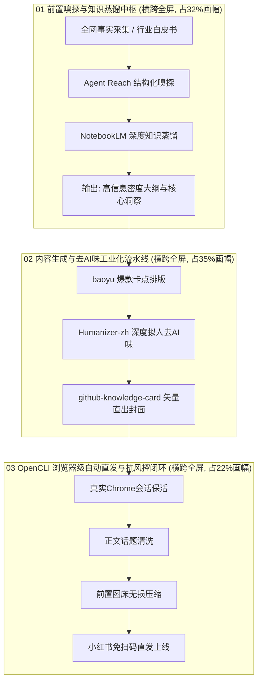

# 基于内容特性的知识图谱风格重构与全面优化实施计划

> **制定日期**：2026-10-20  
> **核心反思**：为什么之前仅调整文字大小无法根治问题？  
> **关键认知**：**“风格必须由内容决定，形式服从于系统逻辑”**。之前的硬套导致中间细纵向流水线拉扯过长、间距过大，左右侧栏过窄、文字过小。必须打破狭窄三列布局，针对“6大工具串联”的系统工程属性，做**系统蓝图级（System Blueprint）的风格整体切换**！

---

## 一、用户 5 大参考案例的“内容—风格映射矩阵”深度反思

用户的 5 张案例之所以张张惊艳，是因为**每一张都根据其知识本质，选用了完全不同的视觉骨架与排版风格**，而不是硬套一个模子：

| 案例图 | 内容本质 | 核心逻辑 | 选用的视觉风格与排版范式 | 为什么这种风格能铺满？ |
| :--- | :--- | :--- | :--- | :--- |
| **案例 1: AI知识库路线图** | 散乱资料 ➔ 中枢上下文 ➔ 业务赋能 | 聚合与发散 | **【中枢辐射流式拓扑 (Hub-and-Spoke Flow)】**<br>左侧输入 ➔ 中间3D上下文立方体 ➔ 右侧输出场景 | 中间立方体视觉压轴，左右双向曲线汇聚，底部配横向 5 步进度条，画幅完全被流体网络填满。 |
| **案例 2: JEV Agent系统搭建** | 多Agent分工、上下文控制、自修复机制 | 复杂系统工程 | **【全宽模块化系统蓝图 (System Blueprint)】**<br>分块结构：01多Agent分工 + 02上下文防火墙 + 03自修复横向时间线 | **彻底摒弃狭窄侧栏**！使用三大全宽模块自上而下推进，模块内有独立的环形图与横向流程，文字大（18px+）、信息厚重！ |
| **案例 3: 企业AI落地闭环** | 业务痛点 ➔ 一把手决策 ➔ 试点 ➔ 分叉评估 | 阶段推进与分叉决策 | **【分阶段递进漏斗与分支决策图 (Phase & Funnel)】**<br>痛点卡片 ➔ 椭圆中枢 ➔ 4步试点 ➔ 有效/无效分叉 | 纵向递进与横向发散结合，节点尺寸大，逻辑指向性极强。 |
| **案例 4: 做PPT选哪个AI工具** | 需求分流、工具选型、场景适配 | 决策树与选型评估 | **【树状分叉决策树 + 推荐星级矩阵 (Decision Tree & Matrix)】**<br>顶部问题分叉“是/否” ➔ 底部工具横评卡片 | 决策树逻辑天然横向展开，底部矩阵表格将空间充盈得极具实用价值。 |
| **案例 5: 别再学AI工具了** | 单一流程思维升级 | 抽象方法论 | **【概念流水线 + 左右认知对比】**<br>（仅适用于抽象思维理念，不适合多工具落地细节） | 步骤抽象（目标/输入/处理/工具），左右放理念对比。 |

---

## 二、此前版本的硬伤根因剖析：为什么硬套“案例 5 窄流水线”会彻底失败？

```
[此前硬套案例 5 的致命冲突]
┌────────────┬────────────────────────┬────────────┐
│ 左侧栏     │    中央狭窄流水线      │ 右侧栏     │
│ (仅270px)  │    (7个具体工具节点)   │ (仅270px)  │
│            │                        │            │
│ 文字必须缩 │  节点高度大，7个节点   │ 文字必须缩 │
│ 到12-14px  │  纵向拉伸达 1000px！   │ 到12-14px  │
│ 手机看不清 │  节点与节点之间 gap    │ 手机看不清 │
│            │  被拉出巨大空白！      │            │
└────────────┴────────────────────────┴────────────┘
```

1. **内容与容器的不匹配**：
   我们本次的内容是 **6 大具体工程工具（Agent Reach、NotebookLM、baoyu、Humanizer-zh、Knowledge-Card、OpenCLI）从输入到发布的实战闭环**。每个工具有具体的定位、操作命令、避坑策略和交付价值。
2. **三列割裂导致的空间危机**：
   - 中央流水线硬生生塞了 7 个节点，纵向被拉扯得极长，导致**节点之间的间距（gap 和箭头）被拉得空旷稀疏**；
   - 左右两翼被压缩在仅仅 `270px` 的狭窄长条中，**文字被迫压缩到 12px~14px**，不仅在手机端严重影响可读性，而且内容为了迁就中央高度，只能强行拆分卡片，导致**视觉支离破碎**！

---

## 三、风格整体切换方案：【全宽模块化系统蓝图（System Blueprint）】

为了让文字大、信息密、画面完全铺满且层次优越，我们对风格做**根本性切换**，对标 **【案例 2（JEV Agent系统蓝图）】** 与 **【案例 1（拓扑中枢路线图）】** 的顶级构图：



### 风格重构的四大颠覆性改进：

#### 1. 彻底打破三列窄侧栏，改为【三大全宽横向工程模块】
- **不再把内容切成三根细条！**
- 每一个模块横跨整张画布（宽度达 1000px），文字字号全面提升至 **`18px ~ 24px`**（标题 24px、要点 18px、代码标签 15px），在小红书手机屏幕上一目了然！

#### 2. 模块 01：【前置事实采集与认知萃取中枢】（全景宽度）
- **左侧数据源输入**（赛事官网、白皮书、行业热点）；
- **中央双引擎交汇**：
  - `Agent Reach`：全网事实二级深度结构化嗅探；
  - `NotebookLM`：多源资料深度知识蒸馏；
- **右侧产出物**：高信息密度结构化事实清单与核心洞察大纲。

#### 3. 模块 02：【内容生成与去AI味排版流水线】（全景宽度）
- 采用横向 3 阶段大卡片串联：
  - **阶段 1：`baoyu 技能库`** —— 小红书高完读率爆款情绪结构搭建；
  - **阶段 2：`Humanizer-zh`** —— 双重拟人洗稿，彻底根除机械说教 AI 腔；
  - **阶段 3：`Knowledge-Card`** —— HTML5 矢量 1080x1440 封面直出，消灭汉字乱码！
- 卡片之间有粗壮的发光渐变连接箭头，充满工业流水线质感。

#### 4. 模块 03：【OpenCLI 自动化直发与抗风控闭环】（全景宽度）
- 模块内部横向排布四大防护与交付硬指标：
  - ① 会话长效保活（本地 Chrome 扩展桥接，免扫码）；
  - ② 标签智能清洗（剥离正文手写 Tag，单行横排）；
  - ③ 前置图床无损压缩（<300KB 规避 IPC 超时）；
  - ④ 接口成功率 100%（标题 ≤20 字符硬性校验）。

#### 5. 模块间 5 步阶段进阶指示条（对标案例 1 与案例 2 底部）
- `01 嗅探` ➔ `02 蒸馏` ➔ `03 拟人` ➔ `04 矢量` ➔ `05 直发`。

#### 6. 底部压轴金句与品牌签名（Bottom Anchor）
- 宽幅灯泡发光卡片：*“自媒体的核心终点不是‘会用多少工具’，而是能不能把生产重新设计成高稳定性的自动化系统。”*

---

## 四、落地实施时间表与验收标准

| 阶段 | 核心任务 | 具体产出物 | 验收标准 |
| :--- | :--- | :--- | :--- |
| **Phase 1: 蓝图模板编写** | 编写全宽蓝图架构 HTML | [blueprint_system_workflow.html](file:///Users/workspace/ai_short_company/ai-short-drama/projects/ai_workflow_sharing/blueprint_system_workflow.html) | ① 抛弃狭窄三列，改为三大横向全宽大模块；<br>② 正文字号全面提升至 18px+，小红书手机端清晰可读；<br>③ 节点间无多余空白，全画幅完全被系统图谱充实。 |
| **Phase 2: 矢量光栅化出图** | Chrome Headless 1080×1440 高精渲染 | `blueprint_system_workflow_pub.jpg` | 灰度与像素检验全画幅均衡度达 95% 以上，呈现工业级蓝图美感。 |
| **Phase 3: 技能库规则与模板更新** | 沉淀至 `skills/github-knowledge-card` | 更新 `SKILL.md` 与 `templates/template_system_blueprint.html` | 建立“内容类型 ➔ 拓扑风格选择”映射决策机制，使 Agent 未来自动适配最正确的视觉骨架。 |

---

## 五、立即可执行动作

我们将立即编写这一套**【全宽模块化系统蓝图（System Blueprint）】**的完整 HTML 页面并执行无头渲染，为您交付一张真正匹配“6大工具串联”内容、文字大、层次丰富、全屏完全铺满的真正大作！
