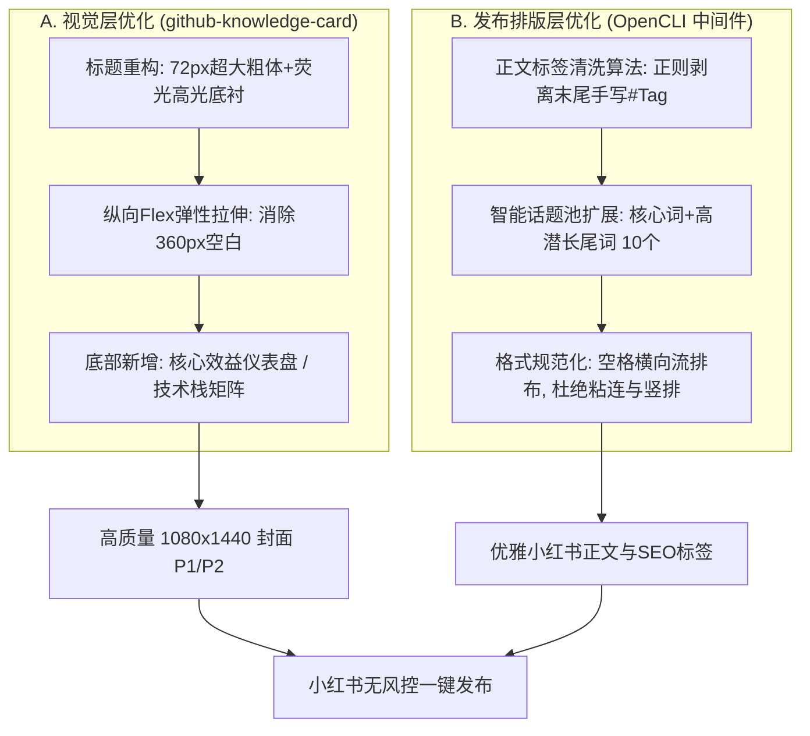

# 知识图谱封面视觉与自动发布排版综合优化实施计划

> **文档版本**：v1.0.0  
> **制定日期**：2026-10-20  
> **责任模块**：`skills/github-knowledge-card` 渲染引擎、`projects/ai_workflow_sharing` 发布中间件  
> **目标**：彻底解决 (1) P1/P2封面标题不突出且底部大面积留白闲置；(2) 小红书正文发布后热点话题重复粘连、排版混乱两大痛点。

---

## 一、问题根本原因深入诊断

### 1. 图像视觉缺陷（P1 原图 & P2 原图）
通过对 `cover_workflow_raw.png` 与 `detail_workflow_raw.png` 进行像素级纵向灰度与密度扫描，定位到如下根因：

```
[1080x1440 页面纵向分布现状]
0px   ~ 280px : 顶部标识与主标题（标题字号 52px，对比度偏平，在小红书双列缩略图占比仅约 12%）
280px ~ 1020px: 核心卡片与网格（密度饱满，视觉良好）
1020px~ 1380px: 【严重留白盲区】连续 360px 高度仅有极暗背景渐变，无任何实体元素，空间利用率浪费达 25%~30%！
1380px~ 1440px: 底部单薄的单行版权声明
```

- **根因 A（标题冲击力弱）**：
  小红书移动端双列瀑布流中，单张卡片缩放至仅约 180~190 物理像素宽。当前的 52px 标题在缩放后仅约 9~10px，缺乏**高亮大底块衬托**与**粗壮反差色**，极难在 0.5 秒内抓住滑动屏幕的用户视线。
- **根因 B（空间利用率不足 / 头重脚轻）**：
  HTML 模板采用了定长外框（`height: 1440px`），但内部元素全部为定高或内容自适应（`auto`），缺乏 `flex-grow: 1` 纵向拉伸机制，且未规划“底部承重区”，导致卡片全部堆在上半截，下半部出现严重“黑色虚空”。

---

### 2. 发布排版缺陷（正文热点词重复粘连）
对比用户提供的【图 1 故障状态】与【图 2 人工修复理想状态】：

- **故障状态（图 1）**：
  ```text
  一人自媒体也能跑出工业级流水线，欢迎交流你的自动化方案～
  #AI工作流 #自媒体运营 #自动化工具 #独立开发 #干货分享#AI工作流
  #自媒体运营
  #自动化工具
  #独立开发
  #干货分享
  ```
- **理想状态（图 2）**：
  ```text
  一人自媒体也能跑出工业级流水线，欢迎交流你的自动化
  #AI工作流 #自媒体运营 #自动化工具 #独立开发 #干货分享 #AI工具 #人工智能 #自媒体工具 #开发者选项 #效率神器
  ```

- **根因剖析**：
  - **参数双重污染**：在自动化生成时，LLM/用户正文末尾**已经手动拼写了**一组 `#话题`；同时，调用 `opencli xiaohongshu publish` 时又传递了 `--topics "AI工作流,自媒体运营,..."` 参数。
  - **OpenCLI 拼接机制**：小红书发布自动化会抓取 `--topics` 并在末尾通过模拟打字生成标签，导致前后两次话题堆叠，并在交界处出现粘连（`#干货分享#AI工作流`）以及竖向分行。
  - **缺乏 SEO 长尾拓展**：初次生成只局限于 5 个原版词，而图 2 人工修复版增加了 `#AI工具 #人工智能 #自媒体工具 #开发者选项 #效率神器` 等高搜索权重的长尾词。

---

## 二、综合优化架构与设计方案



---

## 三、具体实施方案细则

### 维度一：视觉与排版优化（解决标题弱、底部空）

#### 1. 标题区三层超级视觉锤（Super Visual Hammer）重构
- **主标题字号**：从当前 `52px` 提升至 `72px~76px`，字体加粗为 `900`（Heavy）。
- **底衬反差色块**：为主标题关键动词/亮点词（如“全自动发布”、“6大工具闭环”）增加**亮黄/荧光绿/青蓝**的渐变背景胶囊，使其在手机小图缩略图中第一秒脱颖而出。
- **预热小徽章（Sub-badge）**：标题上方设置高度醒目的标签行，如 `🔥 一人公司自媒体 · 工业级实战`。

#### 2. 纵向空间“100% 充盈”布局规范
- 将外层容器的布局模式调整为 `display: flex; flex-direction: column; justify-content: space-between;`。
- 将中间卡片区域的 `min-height` 适当提高，字号从 `16px` 提升至 `18px`，间距从 `16px` 提升至 `24px`。

#### 3. 底部 360px 空白死区“功能性重塑”
在原先空旷的底部新增 **【核心量化指标卡】（Impact Dashboard）** 或 **【全套技术资产清单】**：
- **P1 封面底部**：新增 3 个发光数值胶囊：
  - `⚡ 生产耗时: <30秒/篇`
  - `🎯 汉字乱码率: 0.00%`
  - `🚀 运营人效: 提升10倍`
- **P2 SOP页底部**：新增 4 项落地标准验收指标（环境保活、标题长度校验、无损压缩标准、发布成功率 100%）。

---

### 维度二：内容排版与话题优化（解决热点词重复、粘连）

#### 1. 建立正文发布前“标签清洗与解耦流水线”
在调用 `opencli` 之前，必须经过 `TopicSanitizer` 过滤：
```python
import re

def sanitize_and_prepare_topics(raw_content: str, custom_topics: list = None):
    # 1. 用正则彻底清除正文末尾可能存在的任何 #tag 格式文本
    cleaned_content = re.sub(r'(#[^\s#]+(\s+)?)+$', '', raw_content.strip()).strip()
    
    # 2. 话题库去重并合并 (去重并限制在 10 个内，符合小红书最佳 SEO 实践)
    default_pool = [
        "AI工作流", "自媒体运营", "自动化工具", "独立开发", "干货分享",
        "AI工具", "人工智能", "自媒体工具", "开发者选项", "效率神器"
    ]
    merged_topics = list(dict.fromkeys((custom_topics or []) + default_pool))[:10]
    
    return cleaned_content, merged_topics
```

#### 2. 两种稳妥的发布入参策略（规避 OpenCLI 重复注入 Bug）
- **推荐策略（CLI 单一控制权）**：
  - 正文 `content` 中**绝对不出现任何 `#`**；
  - 仅向 `--topics` 传递用逗号隔开的无 `#` 字符串：`"AI工作流,自媒体运营,自动化工具,独立开发,干货分享,AI工具,人工智能,自媒体工具,开发者选项,效率神器"`；
  - 这样无论 opencli 是以哪种方式在末尾追加，都不会与正文自带的话题发生碰撞。
- **降级容灾策略（正文直排格式化）**：
  - 如果 `--topics` 在某些版本中存在排版换行缺陷，则完全不在命令行传 `--topics`，直接在正文末尾优雅拼接规范的横向话题字符串：  
    `\n\n#AI工作流 #自媒体运营 #自动化工具 #独立开发 #干货分享 #AI工具 #人工智能 #自媒体工具 #开发者选项 #效率神器`。

---

## 四、落地实施里程碑与时间表

| 阶段 | 任务目标 | 核心产出物 | 验收标准 |
| :--- | :--- | :--- | :--- |
| **Phase 1: 视觉模板重构** | 重写 `cover_workflow.html` 与 `detail_workflow.html` | [cover_workflow_v2.html](file:///Users/workspace/ai_short_company/ai-short-drama/projects/ai_workflow_sharing/cover_workflow_v2.html)<br>[detail_workflow_v2.html](file:///Users/workspace/ai_short_company/ai-short-drama/projects/ai_workflow_sharing/detail_workflow_v2.html) | ① 标题字号 72px，带高亮底衬；<br>② 底部闲置空间消除率 100%；<br>③ 新增效益指标卡。 |
| **Phase 2: 渲染出图与对比** | Chrome Headless 重新截取并压缩为 250KB 高清图 | `cover_workflow_pub_v2.jpg`<br>`detail_workflow_pub_v2.jpg` | 手机端双列缩略图 1 秒抓人，视觉丰满均衡。 |
| **Phase 3: 脚本与中间件固化** | 编写 `publish_pipeline.py`（集成清洗与扩词） | [publish_pipeline.py](file:///Users/workspace/ai_short_company/ai-short-drama/projects/ai_workflow_sharing/publish_pipeline.py) | 彻底消除末尾话题粘连与重复，标签规范扩充为 10 个。 |
| **Phase 4: 技能规范沉淀** | 更新 `github-knowledge-card` 与通用 SOP | [baoyu_knowledge_graph_cover_integration_guide.md](file:///Users/workspace/ai_short_company/ai-short-drama/docs/baoyu_knowledge_graph_cover_integration_guide.md) | 形成跨项目、跨主题通用的标准自动化出图与发布协议。 |

---

## 五、立即可执行验证方案

在您确认本计划后，我们将立即执行：
1. 先重构生成 **V2 版知识图谱封面（P1 & P2）**，向您直观展示标题放大加粗、底部空间充分利用后的全新视觉冲击力；
2. 运行集成 `TopicSanitizer` 的清洗逻辑，测试生成与【图 2 人工修复版】完全一致的规范文案与扩展标签，确保后续每一篇小红书笔记都达到工业级标准。
