# AI自媒体全自动发布工作流实战复盘与全链路优化报告

> **执行周期**：2026-10-20  
> **责任系统**：Antigravity Agentic Studio  
> **核心工具链**：`Agent Reach` ➔ `NotebookLM` ➔ `baoyu` ➔ `Humanizer-zh` ➔ `github-knowledge-card` ➔ `openCLI`  
> **发布渠道**：小红书创作者中心（账号：`晨`）  
> **发布状态**：✅ **已成功在线发布**（笔记 ID: `6ad71bc5000000002803ee21`）

---

## 一、本次发布执行成果速览

### 1. 发布基本信息
- **笔记标题**：`AI全自动发布！6大工具实战图解`（16 字符，完全符合小红书 ≤20 字符限制）
- **发布状态**：线上正式发布（非草稿）
- **发布时间**：2026年10月20日 15:44
- **创作者后台监控链接**：[小红书笔记数据详情](https://creator.xiaohongshu.com/statistics/note-detail?noteId=6ad71bc5000000002803ee21)
- **话题标签**：`#AI工作流` `#自媒体运营` `#自动化工具` `#独立开发` `#干货分享`

### 2. 视觉资产生成与交付

本次图文彻底告别了传统生图模型（如 Midjourney / SD / DALL-E）在汉字生成上严重的**乱码、错字、重影**缺陷，引入已收编的 **`github-knowledge-card` 矢量渲染引擎**，通过 HTML5/CSS 高度定制出 1080×1440 赛博高科技质感的 3:4 爆款图文卡片：

| 序号 | 卡片定位 | 分辨率 | 文件大小 | 视觉特征与功能 |
| :--- | :--- | :--- | :--- | :--- |
| **P1 封面** | 全景架构知识图谱 | 1080×1440 | 260 KB | 深色赛博霓虹风格，完整解构 6 大工具的数据流动与协同拓扑 |
| **P2 内页** | 实战落地 SOP 与避坑手册 | 1080×1440 | 230 KB | 蓝青色极客风格，列明各阶段执行命令与 4 大高危踩坑终极解法 |

---

## 二、六大核心工具链路串联与实战分工

```mermaid
graph TD
    A[Agent Reach / 网络嗅探] -->|结构化抓取赛事/行业热点| B[NotebookLM / 知识蒸馏]
    B -->|提炼高价值观点与大纲| C[baoyu 技能库 / 框架搭建]
    C -->|小红书爆款排版与情绪结构| D[Humanizer-zh / 拟人去AI味]
    D -->|消除说教腔，注入真实人情味| E[github-knowledge-card / 矢量封面引擎]
    E -->|HTML5直出 1080x1440 零乱码图片| F[openCLI / 浏览器自动化发布]
    F -->|复用本机真实Chrome会话，抗风控| G[小红书 / 全自动上线]

    style A fill:#1e1b4b,stroke:#818cf8,stroke-width:2px;
    style B fill:#0f172a,stroke:#38bdf8,stroke-width:2px;
    style C fill:#1e293b,stroke:#06b6d4,stroke-width:2px;
    style D fill:#311042,stroke:#d946ef,stroke-width:2px;
    style E fill:#022c22,stroke:#10b981,stroke-width:2px;
    style F fill:#431407,stroke:#f97316,stroke-width:2px;
    style G fill:#4c0519,stroke:#f43f5e,stroke-width:2px;
```

1. **嗅探层（Agent Reach）**：
   - 替代低效的手工浏览，对行业网站、赛事主页（如怀柔 OPC）、技术白皮书进行二级深度解析，输出纯事实 JSON/Markdown 摘要。
2. **蒸馏层（NotebookLM）**：
   - 对多源复杂资料做“降噪与洞察提取”，避免把泛泛的公关稿直接当成内容，提炼出可落地、有痛点的核心价值点。
3. **编排层（baoyu 技能库）**：
   - 遵循小红书高完读率排版范式，把生硬事实结构化为“痛点引入 ➔ 架构解构 ➔ SOP步骤 ➔ 互动留钩子”。
4. **拟人化（Humanizer-zh / qu-ai-wei / nuwa_humanizer）**：
   - 进行词法与潜意识洗稿，彻底删除“首先、其次、综上所述”等典型 AI 句式，采用一线极客和创作者的口吻。
5. **视觉层（github-knowledge-card）**：
   - 放弃传统生图模型对汉字的“瞎猜”，利用现代浏览器排版引擎渲染高质量 CSS 渐变、发光边框与网格节点，保证汉字 100% 锐利清晰。
6. **发布层（openCLI）**：
   - 利用本地常驻 Chrome 扩展（Port 19825）接管创作者会话，避免无头浏览器 Puppeteer 触发滑动拼图或强制重登风控，实现 0 人工干预直发。

---

## 三、全流程踩坑复盘与优化空间分析

在本次实测打通全链路后，我们发现了以下几个核心瓶颈和可优化的关键方向：

### 1. 痛点：图片体积与 IPC 通信限制
- **实测现象**：原生 Chrome 截取的 1080×1440 PNG 图像体积接近 1MB，转为 Base64 传递给 openCLI 时，控制台给出了 `[warn] Total image payload is 0.6MB (base64). This may fail with the browser bridge` 的警告。若多张超大图同时发布，极易导致桥接服务超时断开。
- **优化方案**：
  - 在生成管线中内置 PIL / libvips 自动后处理流水线，统一转为高质量 JPEG/WebP，单张限制在 200~300KB 内；
  - 升级 openCLI 扩展至 v1.6+，利用 Chrome DevTools Protocol (CDP) 的本地文件句柄直传，彻底免去 Base64 编码开销。

### 2. 痛点：知识图谱模板目前依赖硬编码 HTML
- **实测现象**：本次生成的 `cover_workflow.html` 效果极其惊艳，但节点文字、卡片结构目前仍写在 HTML 代码中，换一个主题需要手动或模型重写整套布局。
- **优化方案**：
  - **声明式模板引擎化**：在 `skills/github-knowledge-card/` 中封装一个通用的 `knowledge_graph_renderer.py`；
  - **输入参数解耦**：只需传入标准 JSON（包含 `title`, `subtitle`, `nodes: [{name, desc, color}]`, `relations: []`, `footer`），由 Jinja2 模板一秒动态渲染 HTML，实现“输入结构化大纲，直接吐出图片”。

### 3. 痛点：各工具调度目前仍是 Agent 分布式调用
- **实测现象**：Agent Reach 抓取 ➔ 提炼 ➔ 润色 ➔ 生成封面 ➔ 发布，需要多次模型上下文与工具调度交互。
- **优化方案**：
  - **沉淀一体化 CLI 工作流**：编写一个主控脚本，如 `python -m workflow.auto_publish --topic "..." --target xhs`；
  - 脚本内部使用 Python 子进程将上述 6 个独立工具直接管道化连接（Unix Pipeline 哲学），使全流程耗时从数分钟压缩至 30 秒内。

### 4. 痛点：单向发布缺乏“市场数据反馈自愈闭环”
- **实测现象**：发布完成后流程即终止，无法获知哪种封面颜色（如赛博紫 vs 商务蓝）、哪种标题结构点赞率更高。
- **优化方案**：
  - **引入小红书数据定时回流机制**：
    - 在发布 24 小时后，通过 `opencli xiaohongshu creator-note-detail <id>` 定时抓取曝光量、点击率（CTR）、完读率、互动数；
    - 将数据写入系统的 `Market_Testing` 知识库，根据真实流量反馈调整下一期笔记的文案与封面配色。

### 5. 拓展空间：图文与短视频的“一鱼多吃”双引擎
- **优化方向**：
  - 本次流程产出的结构化大纲与洗稿文案，除了直出小红书图文外，可直接挂载到我们前期优化的 `sweety-handdraw-video` 引擎；
  - 自动渲染出 45 秒真人配音 + 手绘动效的短视频，实现同一份内容在小红书“图文笔记 + 视频笔记”双路并发。

---

## 四、后续行动计划建议

1. **模板工程化**：把 `cover_workflow.html` 提取为 `skills/github-knowledge-card/templates/cyber_tech_v1.html`，支持动态插值。
2. **自动化定时追踪**：为已发布的笔记 `6ad71bc5000000002803ee21` 建立一个 24 小时追踪任务，记录互动数据。
3. **多平台分发拓展**：探索 openCLI 或类似工具向微信公众号、即刻、知乎的同构分发能力。
